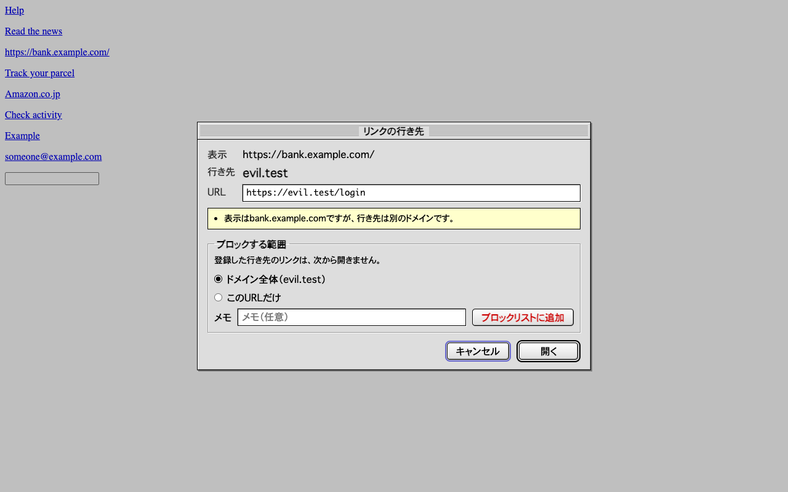
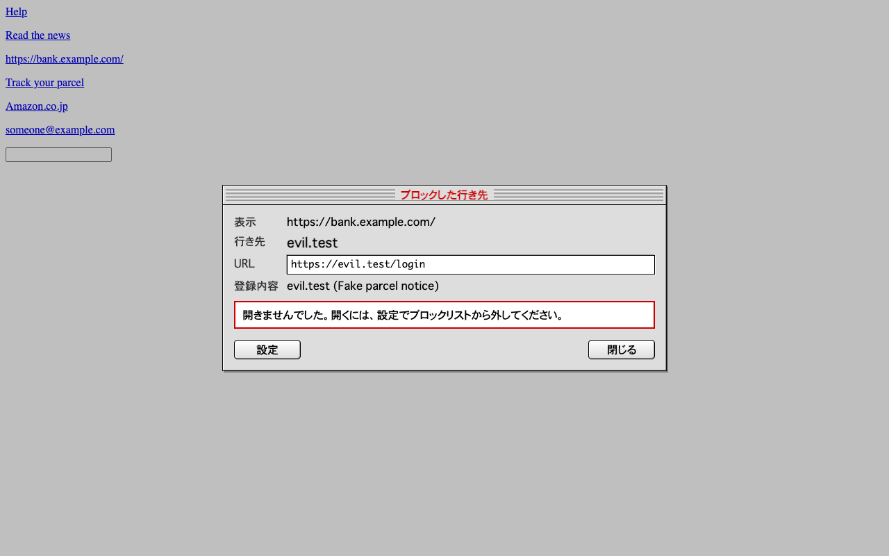

# Mail Link Guard

[English](README.md)

Webメールのリンクを開く前に、実際の行き先を表示するChrome拡張機能です。
ブロックリストに登録した行き先は開きません。
保存するのは設定とブロックリストだけで、外部とは通信しません。
MIT Licenseのオープンソースです。



## できること

- メール本文のリンクをクリックすると、開く前に表示文字、行き先のドメイン、URLを表示します。似せたドメインは実際の文字（例：`αmazon.co.jp`）でも表示します。
- 表示と行き先の食い違い、HTTP、IPアドレス、Punycode、短縮URL、URLの「@」の前の文字、だれでもページを作れるサイト、URLが転送しそうな別のサイト（オープンリダイレクト）があれば知らせます。「安全」とは判定しません。
- Googleのリダイレクト（google.com/url）とMicrosoftのSafe Linksを外して行き先を表示します。開くときは元のURLを使います。
- ダイアログで範囲（ドメイン全体かそのURLだけ）を選び、「ブロックリストに追加」を押すと登録できます。登録した行き先は、リダイレクト経由でも本文の外でも開きません。
- 設定画面で、ブロックリストの絞り込み、追加、削除、JSONのインポートとエクスポートができます。

動くのは`https://mail.google.com/*`だけです。



## インストール

Chrome Web Storeでは審査中です。公開されたら、ここにストアのリンクを載せます。
それまでは、次の手順で入れてください。プログラムの知識は要りません。

### 1. ファイルをダウンロードする

1. [Releasesのページ](https://github.com/tysmmsy/mail-link-guard/releases/latest)を開きます。
2. 「Assets」の欄にある`mail-link-guard-0.1.3.zip`（数字は版によって変わります）をクリックして、ダウンロードします。

### 2. 置き場所を決めて展開する

ダウンロードしたzipは、消さない場所に置いてから展開してください。
Chromeは展開したフォルダを毎回読み込むため、フォルダを消したり動かしたりすると、拡張機能が使えなくなります。
「ダウンロード」フォルダは整理で消してしまいやすいので、避けるのがおすすめです。

- Macの例：ホームフォルダに`Chrome拡張機能`というフォルダを作り、その中にzipを移します。zipをダブルクリックすると、同じ場所に`mail-link-guard-0.1.3`というフォルダができます。
- Windowsの例：`ドキュメント`の中に`Chrome拡張機能`というフォルダを作り、その中にzipを移します。zipを右クリックして「すべて展開」を選びます。

できたフォルダの名前は、版の数字を外して`mail-link-guard`に変えてください。
新しい版に入れ替えるときも同じ名前のフォルダを使うと、登録したブロックリストなどの設定がそのまま残ります。
フォルダを開き、中に`manifest.json`というファイルがあることを確かめてください。

### 3. Chromeに読み込む

1. Chromeのアドレスバーに`chrome://extensions`と入力して開きます。
2. 右上の「デベロッパー モード」をオンにします。
3. 左上に出てくる「パッケージ化されていない拡張機能を読み込む」をクリックします。
4. 手順2で展開したフォルダ（`manifest.json`が入っているフォルダ）を選び、「選択」を押します。
5. 一覧に「Mail Link Guard」が出れば完了です。ツールバーのパズルのアイコンから、ピン留めしておくと使いやすくなります。
6. 開いているGmailのタブがあれば、再読み込みしてください。

### 新しい版に入れ替えるとき

1. 新しいzipをダウンロードして展開します。
2. `Chrome拡張機能`フォルダの中の`mail-link-guard`フォルダの中身を、新しく展開したフォルダの中身で置き換えます（フォルダの名前と場所は変えません）。
3. `chrome://extensions`でMail Link Guardのカードにある再読み込みのボタン（丸い矢印）を押し、開いているGmailのタブも再読み込みします。

ストアで公開された後は、ストアから入れれば自動で更新されるので、この入れ替えは要りません。

### 入れた直後の設定

入れた直後から、次の状態で動きます。どれも設定画面（ツールバーのアイコンを右クリックして「オプション」）から変えられます。

| 項目 | 初期の状態 | そうしている理由 |
|---|---|---|
| リンクの確認 | オン | 入れただけで守られるようにするためです。オフにするとブロックも止まります |
| ブロックリスト | なりすましのよくある形を止める6件を登録済み | ギリシャ文字やキリル文字でAmazonやPayPalなどに似せたドメイン、URLの「@」の前の文字、IPアドレス、`.zip`と`.mov`のドメインは、正規のメールではほとんど使われず、フィッシングに使われやすいためです。「疑わしいものは止める」方針で入れています。社内システムをIPアドレスで開く場合など、不要な項目は削除できます |
| 許可リスト | 空 | ダイアログを省く設定は抜け道になりうるため、本人が必要だと判断したサイトだけを、設定画面から登録する形にしています |

ブロックリストの6件は、最初に入れたときに一度だけ登録します。削除した項目が、更新で戻ることはありません。

## ブロックリスト

| 種類 | 対象 | 例 |
|---|---|---|
| ドメイン | そのドメインとサブドメイン | `evil.example` |
| URL | その文字列で始まるURL。大文字と小文字、エンコード（`e`を`%65`と書くなど）、`#`以降の違いは無視するので、同じページの別の書き方にも当たります。できればドメインで登録してください | `https://cdn.example.com/phish/` |
| ワイルドカード | `*`は任意の文字列です。`/`がなければドメイン、`://`があればURL全体、それ以外はドメインとパスと照合します。 | `*.amaz0n.*`、`*α*`、`*/wp-admin/*` |
| 正規表現 | URL全体と照合します。500文字までです。 | `^https?://[^/]*paypa[l1]\.` |

大文字と小文字は区別しません。
ワイルドカードと正規表現は、`xn--mazon-c9d.co.jp`の形と`αmazon.co.jp`の形の両方と照合するので、似せた文字をそのまま書けます。
たとえば`*α*`で、αを含むドメインをすべて止められます。

正規表現はクリックのたびに実行されます。
`(a+)+`のような書き方はURLによって時間がかかるため、単純なパターンにしてください。
他の人のファイルをインポートするときは、正規表現の中身を確かめてください。

### ファイルの形式

インポートとエクスポートはJSONです。
1行に1項目を書き出すので、Gitで管理しても差分は1行単位で読めます。

```json
{
  "format": "mail-link-guard/blocklist",
  "version": 1,
  "exportedAt": "2026-10-18T00:00:00.000Z",
  "entries": [
    {"type":"domain","value":"evil.example","note":"宅配業者を装ったメール","addedAt":"2026-10-18T00:00:00.000Z"},
    {"type":"wildcard","value":"*.amaz0n.*","note":"","addedAt":"2026-10-18T00:00:00.000Z"}
  ]
}
```

インポートは、項目の配列や、`["evil.example", "*.amaz0n.*"]`のような文字列の配列も読めます。
文字列の種類は自動で判別します（`/.../`は正規表現、`*`を含めばワイルドカード、パス付きのURLはURL、それ以外はドメイン）。

### 上限

| 対象 | 上限 |
|---|---|
| 自分のブロックリスト | 10,000件 |
| インポートするファイル | 2MB |
| ワイルドカードと正規表現の長さ | 500文字 |
| メモ | 200文字 |
| 組織のポリシーで配る項目 | 拡張機能側の上限なし（10,000件には数えない） |

10,000件は、`chrome.storage.local`の上限（10MB）に余裕を残し、クリックごとの照合を速く保つための値です。1件はおよそ100〜200バイトです。

### 初期登録

インストール時に、次の6件を登録します。
疑わしいものは止める方針です。
不要なら削除でき、更新で戻ることはありません。

ギリシャ文字やキリル文字を1文字でも含むドメインをすべて止めたい場合は、次の正規表現を登録してください。
ふつうのロシア語、ウクライナ語、ギリシャ語などのサイト（`яндекс.рф`など）も止まるため、初期登録には入れていません。ラテン文字に見せかける使い方は、初期登録で止まります。

```text
^https?://[^/?#]*[\u0370-\u03ff\u0400-\u052f]
```

| 止めるもの | 例 |
|---|---|
| ギリシャ文字でAmazonに似せたドメイン | `αmazon.co.jp`、`amazοn.com` |
| ラテン文字にギリシャ文字やキリル文字を混ぜたドメイン | `pаypal.com`（キリル文字のа）、`gοogle.com`（ギリシャ文字のο） |
| ラテン文字に見えるギリシャ文字やキリル文字だけのドメイン | `аррӏе.com`（appleに見えるがラテン文字を含まない） |
| アドレスに「@」の前の文字を含むURL。ブラウザは「@」の後ろのホストへ行く | `https://paypal.com@evil.example/` |
| ドメインではなくIPアドレスへのリンク | `http://192.0.2.10/login` |
| ファイル名に見える`.zip`と`.mov`のドメイン | `https://invoice.zip/` |

ふつうのロシア語、ギリシャ語、日本語、アクセント付きのドメイン（`яндекс.рф`、`αλφα.gr`、`例え.jp`、`café.fr`）と、`https://example.com/v1.zip`のようなファイルへのリンクは止めません。
社内のシステムをIPアドレスで開くリンクも止めるので、必要なら該当の項目を削除してください。
正規表現は[src/core/blocklist.ts](src/core/blocklist.ts)の`DEFAULT_PATTERNS`にあります。

## プライバシー

`chrome.storage.local`に保存するのは次の3つだけです。

| 項目 | 中身 |
|---|---|
| `enabled` | リンクを確認するかどうか |
| `blocklist` | 各項目の種類、値、メモ、登録日 |
| `allowlist` | 許可したホスト、サブドメインを含むか、メモ、登録日 |

クリックしたリンクのURLと文字は、ダイアログを表示している間だけメモリに置きます。
メールの内容や履歴は保存しません。

- 外部と通信しません。通信用のAPIをコードに含めず、拡張機能のページのCSPで`connect-src 'none'`を指定しています。操作中に通信が起きると失敗するe2eテストもあります。
- 同期しません。`chrome.storage.local`はChromeの同期の対象外です。
- ダイアログは閉じたShadow DOMの中にあり、表示内容や入力した文字はメールのページから読めません。
- 組織の設定は、読み取り専用の`chrome.storage.managed`から読むだけです。
- データが端末の外に出るのは、自分でブロックリストをエクスポートしたときだけです。

詳しくは[PRIVACY.md](PRIVACY.md)を参照してください。

## 許可リスト

許可リストのサイトへのリンクは、ダイアログを出さずに開きます。
毎回ダイアログが出ると中身を読まずに「開く」を押す癖がつくため、ふだん使うサイトだけ確認を省けるようにしています。
いちばん危険な設定なので、意図して狭くしています。

- 登録は設定画面からだけで、ダイアログからはできません。怪しいリンクを前にした勢いで許可しないためです。
- 登録するのはホスト名で、完全一致です。「サブドメインも含める」を選んだときだけサブドメインも許可します。
- ブロックリストが優先です。両方に当たる行き先は止めます。
- 注意点が1つでもあるとき、HTTPS（標準のポート）でないとき、URLに`?`以降や`#`以降があるとき、パスに`\`、`:`、`@`、`//`があるとき（リダイレクトの転送先が入る場所です）は、ダイアログを出します。判定はリダイレクトを外した後の行き先で行います。
- だれでもページを作れるサイト（`sites.google.com`、`github.io`、`sharepoint.com`、`notion.site`など）と短縮URLは登録できません。サブドメインを含めるとそれらを覆う場合（`google.com`は`sites.google.com`を含む）も断ります。こうしたサイトへのリンクには、ダイアログで注意を表示します。
- 許可リストはインポートできません。組織ではポリシーで配ります。
- 上限は1,000件です。

許可したサイト自体が乗っ取られた場合は防げません。
これらの制限を決めた経緯と、変更するときに示すべき反論の条件は[docs/decisions/0001-allowlist.ja.md](docs/decisions/0001-allowlist.ja.md)にあります。

## 権限

| 権限 | 理由 |
|---|---|
| `https://mail.google.com/*`のコンテンツスクリプト | リンクのクリックを止めるため |
| `storage` | 設定とブロックリストを保存するため |

## できないこと

- 表示するのは最初の行き先だけです。その先のリダイレクト（短縮URLの行き先を含む）は追いません。
- 右クリックメニューの「新しいタブで開く」とドラッグは止められません。
- 注意点は手がかりにすぎず、危険なリンクの多くはどれにも当てはまりません。
- 本文の判定は本文の要素のクラス名に頼っています。画面の作りが変わると、更新するまで本文のリンクは確認なしで開きます。ブロックリストの行き先は、その間も止めます。

## 言語

Chromeの表示言語に合わせて切り替わります。
英語、日本語、簡体字中国語、繁体字中国語、韓国語、スペイン語、ブラジルポルトガル語、フランス語、ドイツ語、イタリア語、ロシア語に対応し、それ以外は英語で表示します。
英語と日本語以外は機械翻訳を元にしているため、修正を歓迎します。
方法は[CONTRIBUTING.md](CONTRIBUTING.md)にあります。

## 組織での展開

管理者はChromeのポリシーで、リンクの確認を常にオンにする、削除できないブロックリストを配る、利用者自身の登録を止める、の3つを強制できます。
Google管理コンソール、Windowsのグループポリシー、macOSの構成プロファイルに対応しています。
詳しくは[docs/enterprise.ja.md](docs/enterprise.ja.md)を参照してください。

## 開発

Node.js 24とpnpmが必要です。

```sh
pnpm install
pnpm build          # dist/ に拡張機能を書き出す
pnpm test           # 単体テスト
pnpm test:e2e       # Chromiumで動作を確かめる
pnpm lint
pnpm typecheck
pnpm package        # release/mail-link-guard-<version>.zip を作る
pnpm screenshots    # release/screenshots/ に画面を書き出す
pnpm icons          # static/icons/ を描き直す
pnpm policy list.json  # 書き出したブロックリストからポリシー用JSONを作る（docs/enterprise.ja.md）
```

自分のChromeで試すときは、`chrome://extensions`でデベロッパーモードをオンにし、「パッケージ化されていない拡張機能を読み込む」で`dist/`を選びます。
ビルドし直したら、拡張機能の再読み込みボタンを押します。
e2eテストの前に、一度だけ`pnpm exec playwright install chromium`を実行してください。

メールのページとバックグラウンドで動くコードは圧縮せず、そのまま読めるようにしています。
設定画面とポップアップは、速く開くために圧縮しています。

## ライセンス

[MIT License](LICENSE)です。
著作権表示とライセンス本文を含めれば、商用を含めて利用、改変、再配布できます。
無保証です。

- 配布物には`LICENSE.txt`と、同梱ライブラリ（MIT、ISC、Apache-2.0、0BSD）のライセンスをまとめた`THIRD_PARTY_NOTICES.txt`を入れています。
- アイコンも同じライセンスです。
- 改変版を公開するときは、名前とアイコンを変えてください。利用者が見分けやすくなります。

## コントリビュート

IssueとPull Requestを歓迎します。
進め方は[CONTRIBUTING.md](CONTRIBUTING.md)、脆弱性の報告は[SECURITY.md](SECURITY.md)を参照してください。
コントリビュートはMIT Licenseで受け付けます。
