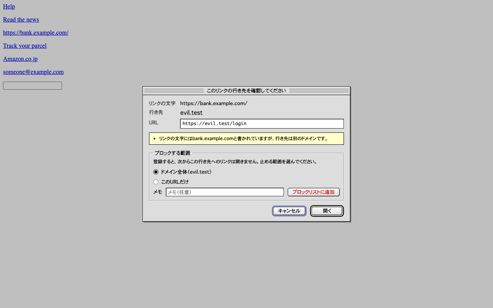
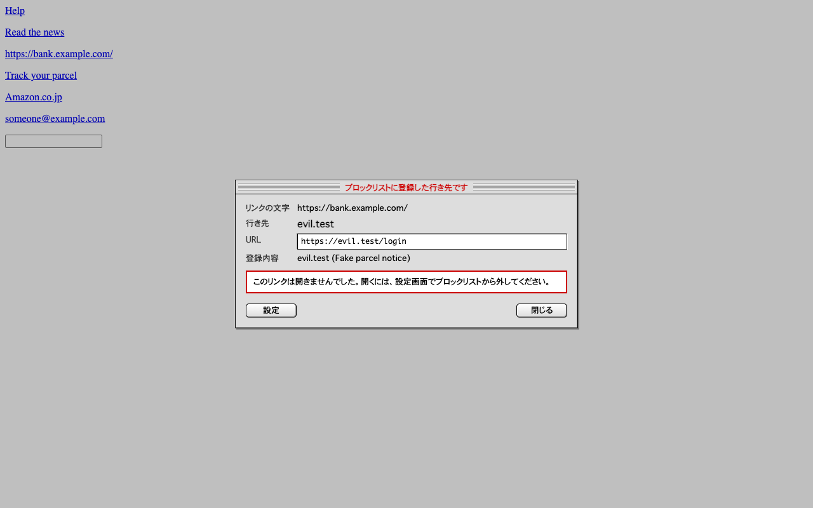

# Mail Link Guard

[日本語](README.ja.md)

Mail Link Guard is an open source Chrome extension (MIT License) that pauses a link click in webmail and shows where the link really goes before it opens. Destinations on your own blocklist are never opened. Everything stays in your browser: the extension stores only its on/off setting and your blocklist, and it makes no network requests.



## What it does

- A click on a link in a message body is held, and a dialog shows the link text, the destination domain and the full URL. Lookalike domains are shown in their real characters (for example `αmazon.co.jp`) next to the `xn--` form.
- The dialog points out format issues when they apply: link text naming a different domain, unencrypted HTTP, an IP address instead of a domain, Punycode domains, URL shorteners, and text before `@` in the URL. It never claims a link is "safe".
- Google's `google.com/url` redirect and Microsoft Safe Links are unwrapped so the real destination is shown. Opening the link still goes through the original URL.
- The "Add to blocklist" section of the dialog registers the whole domain or just that URL, with an optional note, in one press of the red "Add to blocklist" button. Blocklisted destinations are blocked on every later click, including through redirects and outside the message body, and the dialog has no Open button for them.
- The options page lists, filters, adds and removes entries, and imports or exports them as JSON.

The extension runs only on `https://mail.google.com/*`.



## Blocklist entries

| Type | Matches | Example |
|---|---|---|
| Domain | The domain and its subdomains | `evil.example` |
| URL | URLs that start with the value (the `#` part is ignored) | `https://cdn.example.com/phish/` |
| Wildcard | `*` matches any characters. Without `/` the pattern is matched against the domain, with `://` against the whole URL, otherwise against domain + path. Case-insensitive. | `*.amaz0n.*`, `*α*`, `*/wp-admin/*` |
| Regular expression | A JavaScript regular expression tested against the whole URL, ignoring case. Up to 500 characters. | `^https?://[^/]*paypa[l1]\.` |

Wildcards and regular expressions are tested against the URL both as the browser holds it (`xn--mazon-c9d.co.jp`) and with the domain decoded to Unicode (`αmazon.co.jp`), so a pattern can name the lookalike characters directly. `*α*`, for example, blocks every domain that contains a Greek alpha.

A new install starts with three entries that follow "block when in doubt". Each one targets domains written to be mistaken for Latin text, and you can remove any of them like other entries:

| Catches | Examples |
|---|---|
| Domains that imitate "amazon" using Greek letters | `αmazon.co.jp`, `amazοn.com` |
| A domain label that mixes Latin letters with Greek or Cyrillic | `pаypal.com` (Cyrillic а), `gοogle.com` (Greek ο) |
| A domain label written only with Greek or Cyrillic letters that look Latin | `аррӏе.com` (reads as "apple", contains no Latin) |

Ordinary Russian, Greek, Japanese or accented domains (`яндекс.рф`, `αλφα.gr`, `例え.jp`, `café.fr`) are not affected, because they do not mix scripts and contain letters that do not look Latin. The exact regular expressions are in `DEFAULT_PATTERNS` in [src/core/blocklist.ts](src/core/blocklist.ts).

They are added only on the first install, so an entry you removed does not come back with an update.

A regular expression runs on every click in a message, and a badly written one (nested repetition such as `(a+)+`) can take a long time on some URLs. The URL is cut to 4,096 characters before testing, but prefer simple patterns, and review regular expressions in files you import from others.

## Privacy

| Stored in `chrome.storage.local` | Contents |
|---|---|
| `enabled` | Whether links are checked |
| `blocklist` | Each entry's type, value, optional note and date added |

Nothing else is stored. Settings an organization enforces arrive through Chrome policy in the read-only `chrome.storage.managed`; the extension does not write them anywhere. The URL and text of a clicked link are kept in memory only while the dialog is open. Message contents, browsing history and click history are never read into storage.

- No network requests. The code contains no `fetch`, `XMLHttpRequest`, `WebSocket`, `EventSource` or `sendBeacon`, the extension pages set `connect-src 'none'` in their Content Security Policy, and an end-to-end test fails if any request is made while links are checked, blocked or added.
- Not synced. `chrome.storage.local` stays on the device and is not part of Chrome Sync.
- Hidden from the mail page. The dialog lives in a closed shadow root, and keystrokes and text typed into it are stopped before the page's own scripts can see them.
- Your data leaves the device only when you export the blocklist to a file yourself.

See [PRIVACY.md](PRIVACY.md).

## Permissions

| Permission | Why |
|---|---|
| Content script on `https://mail.google.com/*` | To hold link clicks in mail |
| `storage` | To keep the on/off setting and the blocklist on the device |

## Limitations

- Only the first destination is shown. Redirects after it, including where a URL shortener leads, are not followed.
- Opening a link from the right-click menu ("Open link in new tab") or by dragging it is not intercepted.
- The format notes are hints. Many dangerous links have none of them.
- Body links are recognized by the class name of the message body container. If the mail page changes its markup, body links pass unchecked until the extension is updated; blocklisted destinations are still blocked anywhere on the page.

## Languages

The interface follows Chrome's display language. It is available in English, Japanese, Simplified Chinese, Traditional Chinese, Korean, Spanish, Brazilian Portuguese, French, German, Italian and Russian; any other language falls back to English. Translations other than English and Japanese were machine-assisted, and corrections are welcome. [CONTRIBUTING.md](CONTRIBUTING.md) explains how to add or fix a translation.

## Deploying to an organization

Administrators can enforce settings through Chrome policy (Google Admin console, Windows Group Policy, macOS configuration profiles): lock link checking on, push blocklist entries users cannot remove, and turn off users' own entries. See [docs/enterprise.md](docs/enterprise.md).

## Design

The settings page and the popup are built with [shadcn/ui](https://ui.shadcn.com/) components (React, Radix UI, Tailwind CSS), restyled after the classic Mac OS "Platinum" look: gray windows, pinstriped title bars and beveled buttons, with no animations. The dialog shown on the mail page is plain DOM with the same look, so the mail page loads no framework and the dialog appears in the same frame as the click.

## Development

Requires Node.js 24 and pnpm.

```sh
pnpm install
pnpm build          # writes the unpacked extension to dist/
pnpm test           # unit tests
pnpm test:e2e       # loads the extension into Chromium and drives a fake mail page
pnpm lint
pnpm typecheck
pnpm package        # release/mail-link-guard-<version>.zip
pnpm screenshots    # release/screenshots/
pnpm icons          # redraws static/icons/ from scripts/make-icons.ts
```

To use it in your own Chrome, turn on Developer mode in `chrome://extensions`, choose "Load unpacked" and select `dist/`. After `pnpm build`, press the reload button on the extension's card. Run `pnpm exec playwright install chromium` once before the e2e test.

The scripts that run on the mail page and in the background are not minified, so the code running next to your mail can be read as written. The settings page and the popup are minified to keep the popup fast.

## License

Mail Link Guard is released under the [MIT License](LICENSE). You may use, copy, modify, merge, publish, distribute, sublicense and sell copies, including for commercial purposes, as long as the copyright notice and the license text are included. The software comes with no warranty.

- The packaged extension includes `LICENSE.txt`, and `THIRD_PARTY_NOTICES.txt` with the license of every bundled package (React, Radix UI, lucide-react, and others; all MIT, ISC, Apache-2.0 or 0BSD). Both are generated into `dist/` by `pnpm build`.
- The icon is drawn by `scripts/make-icons.ts` and is covered by the same license.
- If you publish a modified version, a different name and icon help people tell the versions apart.

## Contributing

Issues and pull requests are welcome. See [CONTRIBUTING.md](CONTRIBUTING.md). Contributions are accepted under the MIT License. Report vulnerabilities as described in [SECURITY.md](SECURITY.md).
