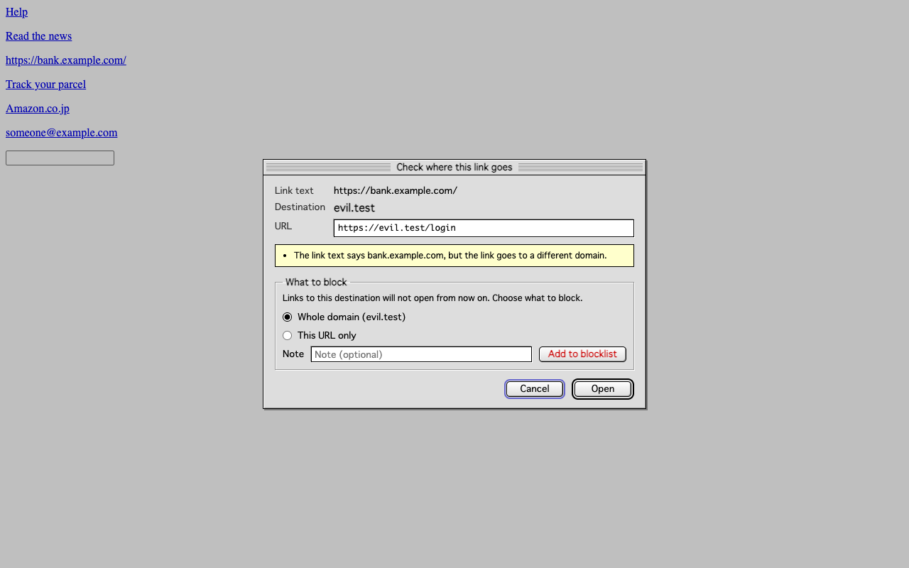
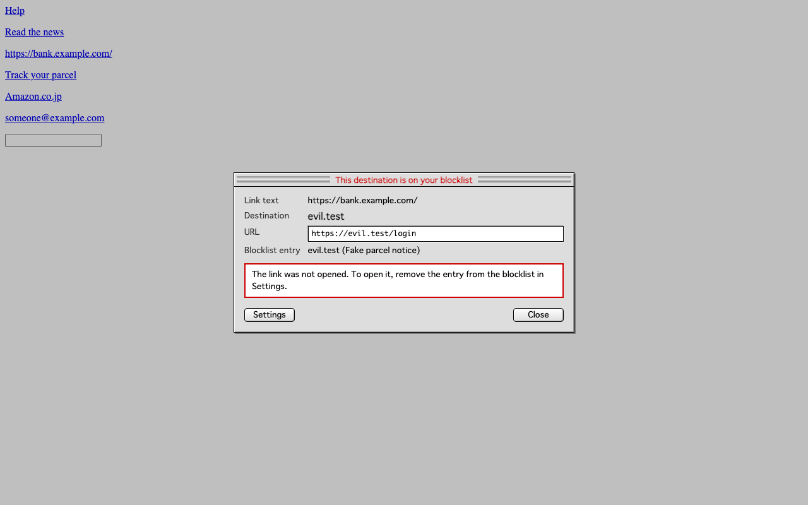

# Mail Link Guard

[日本語](README.ja.md)

Mail Link Guard is an open source Chrome extension (MIT License) that pauses a link click in webmail and shows where the link really goes before it opens. Destinations on your own blocklist are never opened. Everything stays in your browser: the extension stores only its on/off setting, your blocklist and your allowlist, and it makes no network requests.



## What it does

- A click on a link in a message body is held, and a dialog shows the link text, the destination domain and the full URL. Lookalike domains are shown in their real characters (for example `αmazon.co.jp`) next to the `xn--` form.
- The dialog points out format issues when they apply: link text naming a different domain, unencrypted HTTP, an IP address instead of a domain, Punycode domains, URL shorteners, text before `@` in the URL, sites where anyone can publish pages, and another site the URL appears to forward to (an open redirect). It never claims a link is "safe".
- Google's `google.com/url` redirect and Microsoft Safe Links are unwrapped so the real destination is shown. Opening the link still goes through the original URL.
- The "Add to blocklist" section of the dialog registers the whole domain or just that URL, with an optional note, in one press of the red "Add to blocklist" button. Blocklisted destinations are blocked on every later click, including through redirects and outside the message body, and the dialog has no Open button for them.
- The options page lists, filters, adds and removes entries, and imports or exports them as JSON.

The extension runs only on `https://mail.google.com/*`.



## Install

### From the Chrome Web Store

1. Open [Mail Link Guard on the Chrome Web Store](https://chromewebstore.google.com/detail/mail-link-guard/mofhdbekklmpogblinkohjliliopgkog).
2. Click "Add to Chrome", then "Add extension".
3. Reload any open Gmail tabs.

Updates are installed automatically.

If you installed the zip version before, remove it in `chrome://extensions` so the two copies do not both run. The store version keeps its own settings, so export your blocklist from the old copy first and import it into the new one.

### From the zip file

Use this to install a version that is not on the store yet. No programming knowledge is needed.

#### 1. Download the file

1. Open the [Releases page](https://github.com/tysmmsy/mail-link-guard/releases/latest).
2. Under "Assets", click `mail-link-guard-0.1.3.zip` (the number changes with the version) to download it.

#### 2. Put it somewhere permanent and unzip it

Chrome loads the unzipped folder every time it starts, so if the folder is deleted or moved, the extension stops working. The Downloads folder is easy to clean out by accident, so avoid it.

- Mac: create a folder named `Chrome Extensions` in your home folder and move the zip into it. Double-click the zip; a folder named `mail-link-guard-0.1.3` appears next to it.
- Windows: create a folder named `Chrome Extensions` in `Documents` and move the zip into it. Right-click the zip and choose "Extract All".

Rename the new folder to `mail-link-guard`, without the version number. Using the same folder for later versions keeps your blocklist and other settings. Open the folder and check that it contains a file named `manifest.json`.

#### 3. Load it into Chrome

1. Type `chrome://extensions` in Chrome's address bar and press Enter.
2. Turn on "Developer mode" in the top right.
3. Click "Load unpacked" in the top left.
4. Select the folder from step 2 (the one containing `manifest.json`) and click "Select".
5. When "Mail Link Guard" appears in the list, you are done. Pin it from the puzzle-piece icon in the toolbar for easy access.
6. Reload any open Gmail tabs.

#### Updating to a new version

1. Download and unzip the new zip.
2. Replace the contents of the `mail-link-guard` folder inside `Chrome Extensions` with the contents of the new folder. Keep the folder's name and location.
3. In `chrome://extensions`, press the reload button (circular arrow) on the Mail Link Guard card, then reload any open Gmail tabs.

### Initial settings

The extension starts working right away with the settings below. All of them can be changed on the options page (right-click the toolbar icon and choose "Options").

| Setting | Initial state | Why |
|---|---|---|
| Link checking | On | So that installing it is enough to be protected. Turning it off also stops blocking. |
| Blocklist | Six entries that block common impersonation forms | Domains imitating Amazon, PayPal and others with Greek or Cyrillic letters, text before "@" in a URL, bare IP addresses, and `.zip`/`.mov` domains are rarely used in genuine mail and often used in phishing, so they are blocked on a "block when in doubt" basis. Remove any you do not need, for example the IP-address entry if you open internal systems by IP. |
| Allowlist | Empty | Skipping the dialog can become a loophole, so only sites you decide you need are added, on the options page. |

The six blocklist entries are added once, on first install. An entry you remove does not come back with an update.

## Blocklist entries

| Type | Matches | Example |
|---|---|---|
| Domain | The domain and its subdomains | `evil.example` |
| URL | URLs that start with the value. Case, percent-encoding (`%65` for `e`) and the `#` part are ignored, so other spellings of the same page match too. Prefer a domain entry when you can. | `https://cdn.example.com/phish/` |
| Wildcard | `*` matches any characters. Without `/` the pattern is matched against the domain, with `://` against the whole URL, otherwise against domain + path. Case-insensitive. | `*.amaz0n.*`, `*α*`, `*/wp-admin/*` |
| Regular expression | A JavaScript regular expression tested against the whole URL, ignoring case. Up to 500 characters. | `^https?://[^/]*paypa[l1]\.` |

Wildcards and regular expressions are tested against the URL both as the browser holds it (`xn--mazon-c9d.co.jp`) and with the domain decoded to Unicode (`αmazon.co.jp`), so a pattern can name the lookalike characters directly. `*α*`, for example, blocks every domain that contains a Greek alpha.

### File format

Import and export use one JSON file. Entries are written one per line, so a list kept in Git still diffs line by line.

```json
{
  "format": "mail-link-guard/blocklist",
  "version": 1,
  "exportedAt": "2026-10-18T00:00:00.000Z",
  "entries": [
    {"type":"domain","value":"evil.example","note":"fake parcel notice","addedAt":"2026-10-18T00:00:00.000Z"},
    {"type":"wildcard","value":"*.amaz0n.*","note":"","addedAt":"2026-10-18T00:00:00.000Z"}
  ]
}
```

Import also reads a bare array of entries, or of strings such as `["evil.example", "*.amaz0n.*"]`; the type of a string is guessed (`/.../` is a regex, `*` makes a wildcard, a URL with a path is a URL, anything else a domain).

### Limits

| Item | Limit |
|---|---|
| Entries in your own blocklist | 10,000 |
| Import file size | 2 MB |
| Wildcard or regular expression length | 500 characters |
| Note length | 200 characters |
| Entries enforced by an organization | No limit in the extension; not counted toward the 10,000 |

The 10,000-entry limit keeps the list well inside the 10 MB that `chrome.storage.local` allows (an entry takes roughly 100 to 200 bytes) and keeps the check on each click fast.

### Default entries

A new install starts with six entries that follow "block when in doubt". You can remove any of them like other entries:

| Catches | Examples |
|---|---|
| Domains that imitate "amazon" using Greek letters | `αmazon.co.jp`, `amazοn.com` |
| A domain label that mixes Latin letters with Greek or Cyrillic | `pаypal.com` (Cyrillic а), `gοogle.com` (Greek ο) |
| A domain label written only with Greek or Cyrillic letters that look Latin | `аррӏе.com` (reads as "apple", contains no Latin) |
| Text before `@` in the address; the browser goes to the host after `@` | `https://paypal.com@evil.example/` |
| A bare IP address instead of a domain name | `http://192.0.2.10/login` |
| The `.zip` and `.mov` top-level domains, which read like file names | `https://invoice.zip/` |

Ordinary Russian, Greek, Japanese or accented domains (`яндекс.рф`, `αλφα.gr`, `例え.jp`, `café.fr`) are not affected, because they do not mix scripts and contain letters that do not look Latin. Links to files such as `https://example.com/v1.zip` are not affected either. Links to internal systems by IP address are blocked; remove that entry if you need them. The exact regular expressions are in `DEFAULT_PATTERNS` in [src/core/blocklist.ts](src/core/blocklist.ts).

They are added only on the first install, so an entry you removed does not come back with an update.

To block every domain that contains any Greek or Cyrillic letter, add this regular expression. It is not a default because it also blocks ordinary Russian, Ukrainian, Greek and other sites (such as `яндекс.рф`), while the defaults already catch domains that use these letters to look Latin.

```text
^https?://[^/?#]*[\u0370-\u03ff\u0400-\u052f]
```

A regular expression runs on every click in a message, and a badly written one (nested repetition such as `(a+)+`) can take a long time on some URLs. The URL, the host and the host with its path are each cut to 4,096 characters before testing, but prefer simple patterns, and review regular expressions in files you import from others.

## Privacy

| Stored in `chrome.storage.local` | Contents |
|---|---|
| `enabled` | Whether links are checked |
| `blocklist` | Each entry's type, value, optional note and date added |
| `allowlist` | Each allowed host, whether subdomains are included, optional note and date added |

Nothing else is stored. Settings an organization enforces arrive through Chrome policy in the read-only `chrome.storage.managed`; the extension does not write them anywhere. The URL and text of a clicked link are kept in memory only while the dialog is open. Message contents, browsing history and click history are never read into storage.

- No network requests. The code contains no `fetch`, `XMLHttpRequest`, `WebSocket`, `EventSource` or `sendBeacon`, the extension pages set `connect-src 'none'` in their Content Security Policy, and an end-to-end test fails if any request is made while links are checked, blocked or added.
- Not synced. `chrome.storage.local` stays on the device and is not part of Chrome Sync.
- Hidden from the mail page. The dialog lives in a closed shadow root, and keystrokes and text typed into it are stopped before the page's own scripts can see them.
- Your data leaves the device only when you export the blocklist to a file yourself.

See [PRIVACY.md](PRIVACY.md).

## Allowlist

Links to sites on the allowlist open without the dialog, so the dialog keeps its meaning for links that are not routine. Allowing a site is the riskiest setting, so it is narrow on purpose:

- Sites can be added only on the options page, never from the dialog, so allowing is a deliberate choice rather than a click made while looking at a suspicious link.
- Entries are host names. A host matches exactly unless "Include subdomains" is checked.
- The blocklist always wins: a destination on both lists is blocked.
- The dialog still appears when the link raises any note, is not HTTPS on the default port, or has a query (`?…`), a fragment (`#…`) or a path with `\`, `:`, `@` or `//`, where redirect targets travel. The check uses the destination after removing redirect wrappers.
- Sites where anyone can publish pages (such as `sites.google.com`, `github.io`, `sharepoint.com`, `notion.site`) and URL shorteners cannot be added, and "Include subdomains" is refused when it would cover one of them (for example `google.com` would cover `sites.google.com`). Links to these sites show a note in the dialog.
- The allowlist cannot be imported; organizations push allowed sites through policy instead.
- Up to 1,000 sites.

An allowlist cannot protect against an allowed site itself being compromised. The reasoning behind these rules, and what a change to them must argue, is in [docs/decisions/0001-allowlist.md](docs/decisions/0001-allowlist.md).

## Permissions

| Permission | Why |
|---|---|
| Content script on `https://mail.google.com/*` | To hold link clicks in mail |
| `storage` | To keep the on/off setting and the blocklist on the device |

## Limitations

- Only the first destination is shown. Redirects after it, including where a URL shortener leads, are not followed.
- Opening a link from the right-click menu ("Open link in new tab") or by dragging it is not intercepted.
- The format notes are hints. Many dangerous links have none of them.
- Body links are recognized by the class name of the message body container. If the mail page changes its markup, body links pass unchecked until the extension is updated; blocklisted destinations are still blocked anywhere on the page.

## Languages

The interface follows Chrome's display language. It is available in English, Japanese, Simplified Chinese, Traditional Chinese, Korean, Spanish, Brazilian Portuguese, French, German, Italian and Russian; any other language falls back to English. Translations other than English and Japanese were machine-assisted, and corrections are welcome. [CONTRIBUTING.md](CONTRIBUTING.md) explains how to add or fix a translation.

## Deploying to an organization

Administrators can enforce settings through Chrome policy (Google Admin console, Windows Group Policy, macOS configuration profiles): lock link checking on, push blocklist entries users cannot remove, and turn off users' own entries. See [docs/enterprise.md](docs/enterprise.md).

## Development

Requires Node.js 24 and pnpm.

```sh
pnpm install
pnpm build          # writes the unpacked extension to dist/
pnpm test           # unit tests
pnpm test:e2e       # loads the extension into Chromium and drives a fake mail page
pnpm lint
pnpm typecheck
pnpm package        # release/mail-link-guard-<version>.zip
pnpm screenshots    # release/screenshots/
pnpm icons          # redraws static/icons/ from scripts/make-icons.ts
pnpm policy list.json  # prints policy JSON from an exported blocklist (docs/enterprise.md)
```

To use it in your own Chrome, turn on Developer mode in `chrome://extensions`, choose "Load unpacked" and select `dist/`. After `pnpm build`, press the reload button on the extension's card. Run `pnpm exec playwright install chromium` once before the e2e test.

The scripts that run on the mail page and in the background are not minified, so the code running next to your mail can be read as written. The settings page and the popup are minified to keep the popup fast.

## License

Mail Link Guard is released under the [MIT License](LICENSE). You may use, copy, modify, merge, publish, distribute, sublicense and sell copies, including for commercial purposes, as long as the copyright notice and the license text are included. The software comes with no warranty.

- The packaged extension includes `LICENSE.txt`, and `THIRD_PARTY_NOTICES.txt` with the license of every bundled package (React, Radix UI, lucide-react, and others; all MIT, ISC, Apache-2.0 or 0BSD). Both are generated into `dist/` by `pnpm build`.
- The icon is drawn by `scripts/make-icons.ts` and is covered by the same license.
- If you publish a modified version, a different name and icon help people tell the versions apart.

## Contributing

Issues and pull requests are welcome. See [CONTRIBUTING.md](CONTRIBUTING.md). Contributions are accepted under the MIT License. Report vulnerabilities as described in [SECURITY.md](SECURITY.md).
